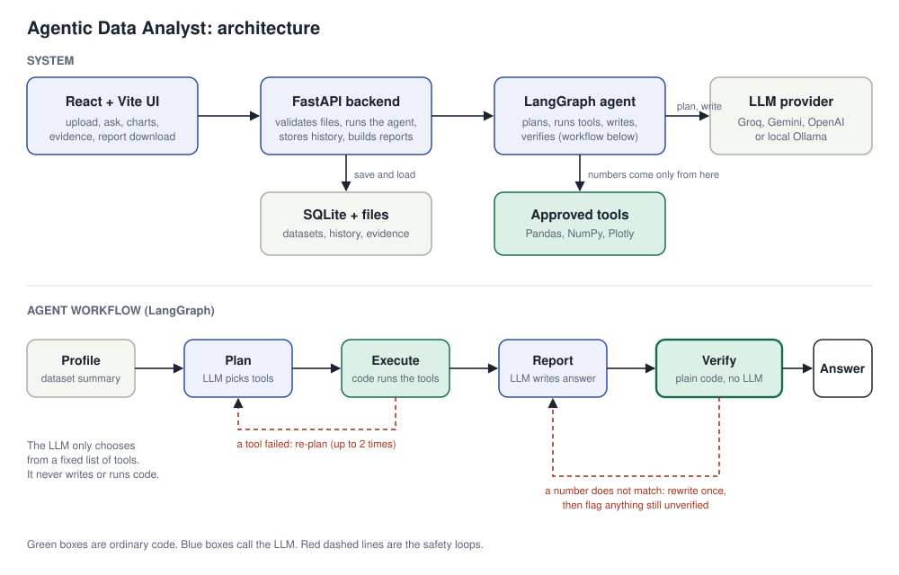

# Agentic Data Analyst

Ask questions about a spreadsheet in plain English and get an answer in which **every number is checked
against the calculation that produced it**.

Minor Project-I, Doon School of Advanced Computing.
Team: Neeraj Choudhary, Charchit Jain, Karan Singh Rathore, Harsh Khendelwal. Mentor: Abhinav Narain.

## What it does

1. You upload a CSV or Excel file and ask a question, for example *"How much higher is North revenue than South revenue, in percent?"*
2. An AI agent decides which analysis to run. It can only choose from a fixed list of approved tools.
3. Python code (Pandas, NumPy) performs every calculation.
4. The AI writes a short answer. A separate checker, plain code with no AI, compares every number in the
   answer with the tool results. Numbers that do not match are rewritten once, then flagged in red.
5. You see the answer with highlighted numbers, charts, the list of calculations behind it, and a downloadable report.



## Why it is built this way

| Problem with typical AI data tools | What this project does |
|---|---|
| The AI does the arithmetic and can invent numbers | The AI only picks tools. Code does the arithmetic |
| The AI could write and run harmful code | No free-form code. Eight fixed, tested tools. No operating-system commands |
| You cannot tell if a number is right | Every number is matched to a calculation and highlighted. Click one to see how it was computed |
| The AI answers questions the data cannot answer | It is evaluated on unanswerable questions and must say so |
| Incomplete periods distort trends | The trend tool compares complete periods only and lists the incomplete ones separately |

## Features

- Upload and validate CSV or Excel files (type, size, row and column limits, cleaned column names)
- Automatic data overview: row and column counts, missing values, a small chart for every column
- Eight analysis tools: dataset summary, group totals, top and bottom rows, correlation, outliers,
  two-group comparison with percent difference, trend over time, and charts
- LangGraph workflow with automatic re-planning when a tool fails
- Number verification with a plain-language verdict and per-number highlighting
- Full evidence trail for every answer, saved history, and a downloadable Markdown report
- Works with Groq, Gemini, OpenAI or a local Ollama model, chosen in one settings file
- Light and dark interface

## Tech stack

| Part | Technology |
|---|---|
| Agent workflow | LangGraph |
| Analysis | Python, Pandas, NumPy, Plotly |
| Backend | FastAPI, Uvicorn, SQLite |
| Interface | React, Vite, Plotly.js |
| Testing | Pytest (backend), Vitest (interface) |
| Packaging | Docker |

## Run it on your computer

You need Python 3.11 or newer and Node.js 18 or newer.

```powershell
# 1. Backend
cd backend
python -m venv .venv
.\.venv\Scripts\Activate.ps1
pip install -r requirements.txt

# 2. Your LLM settings (private file, never share it)
Copy-Item .env.example .env
notepad .env                      # put your key in, save, close

# 3. Build the interface
cd ..\frontend
npm install
npm run build

# 4. Start everything
cd ..\backend
uvicorn app.main:app
```

Open http://127.0.0.1:8000 and click **Try the sample sales data**.

### With Docker

```powershell
Copy-Item backend\.env.example backend\.env      # then edit it
docker compose up --build
```

Open http://localhost:8000.

## Using the interface

1. Upload a file, or use the sample data.
2. Ask a question or pick one of the suggestions.
3. Click a green number to jump to the calculation behind it. A red wavy number could not be matched.
4. Open "How the agent worked" to see planning, calculation, writing and checking.
5. Use "Download report" for a Markdown copy with the evidence table.

## API

| Endpoint | Purpose |
|---|---|
| `POST /datasets` | Upload a file |
| `GET /datasets/{id}` and `/datasets/{id}/profile` | Dataset details and overview |
| `POST /datasets/{id}/analyze` | Ask a question |
| `GET /datasets/{id}/analyses` | History for a dataset |
| `GET /analyses/{id}` and `/analyses/{id}/report.md` | One answer, and its report |

Interactive documentation is at http://127.0.0.1:8000/docs.

## Put it online

See [docs/DEPLOY.md](docs/DEPLOY.md): interface on Vercel, backend on Render, with rate limits that protect your AI quota.

## Evaluation

`backend/evaluation` runs 25 questions against the sample data and scores the agent. The correct answers
are computed separately with plain Pandas, so the agent is compared with an independent calculation.
Three questions cannot be answered from the data, and the agent passes them only by saying so.

```powershell
cd backend
python -m evaluation.run --delay 4
```

The report is saved to `backend/evaluation/results/` and the newest one is always `latest.md`. It shows
correct answers by question type, whether the right tool was chosen, the share of numbers verified,
retries, and response times, plus an explanation of every wrong answer.

## Tests

```powershell
cd backend ; python -m pytest -q        # 102 tests
cd ..\frontend ; npm test               # 28 tests
```

## Project layout

```
backend/
  app/            agent.py (workflow), tools.py, verify.py, llm.py, main.py (API), db.py, profile.py, loader.py
  evaluation/     questions, scoring and the evaluation runner
  tests/
frontend/src/     React interface and its tests
data/             sample dataset
docs/             architecture diagram and demo script
```

## Limitations

- One table at a time. No joins across files
- A fixed set of eight tools. A question outside them gets an honest "cannot compute"
- The checker proves that each number came from a calculation. It cannot prove the AI chose the right calculation, which is why tool choice is measured separately
- Answer quality depends on the LLM that is configured
- Single user, no accounts, SQLite storage

## Future work

More tools (joins, forecasting, grouping by date parts), multi-sheet Excel files, PostgreSQL storage, user accounts.
